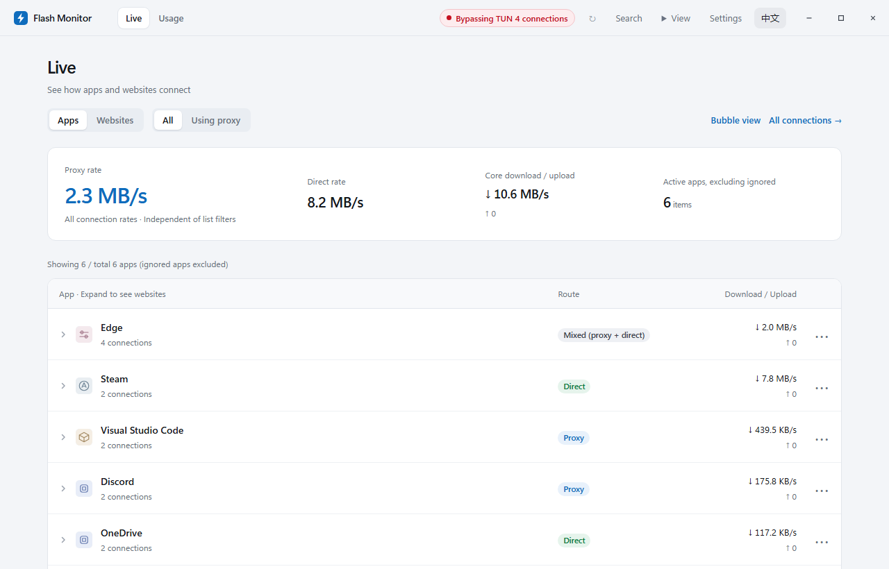
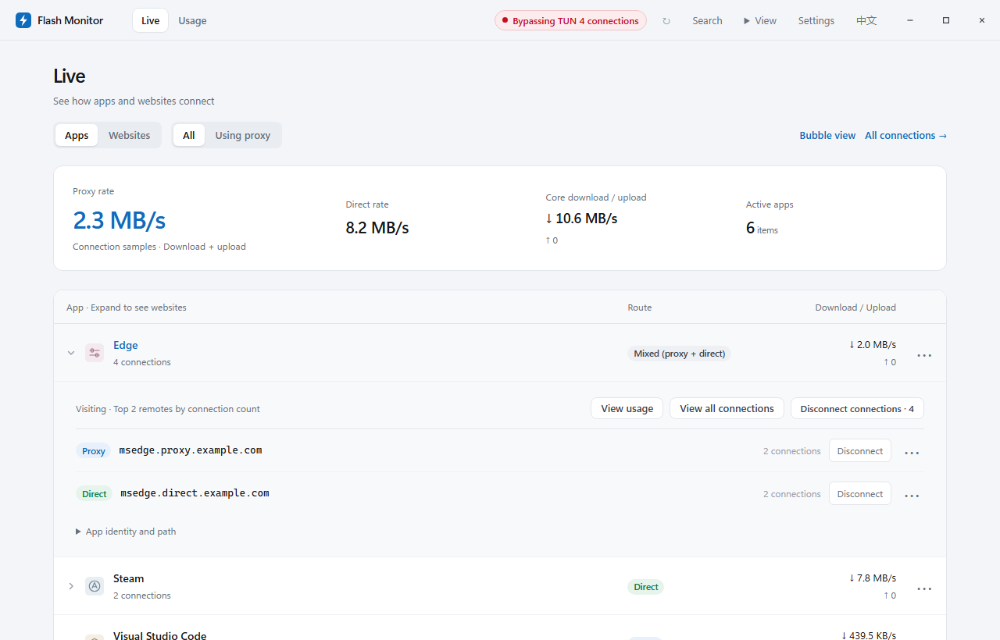
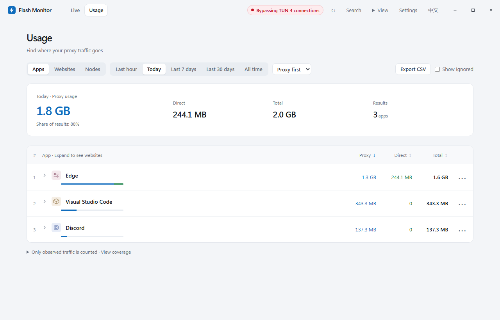
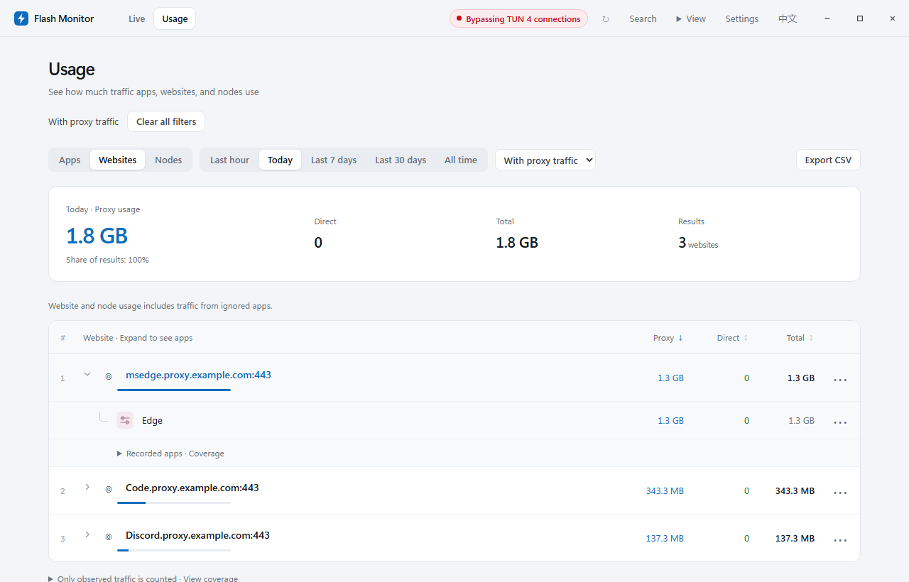
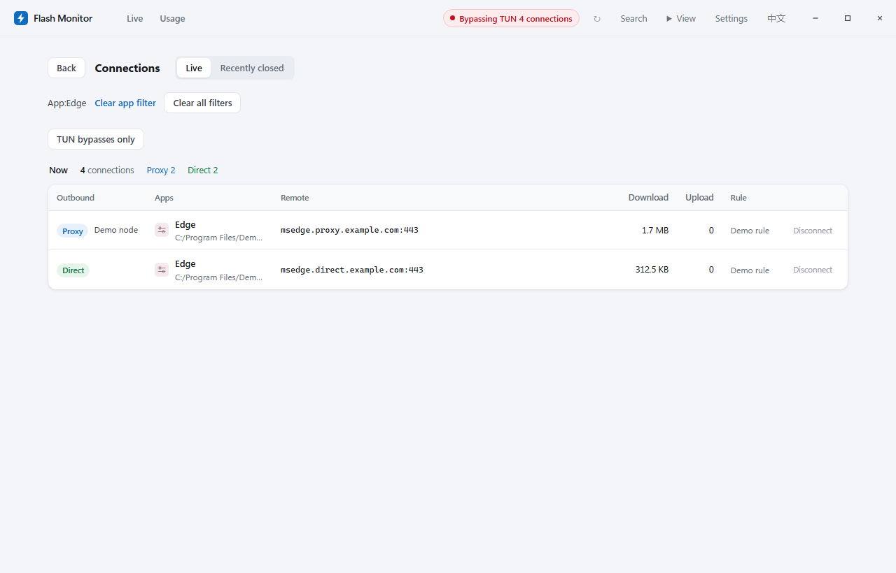
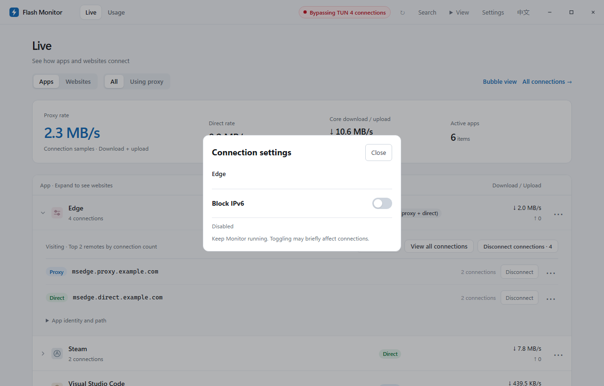
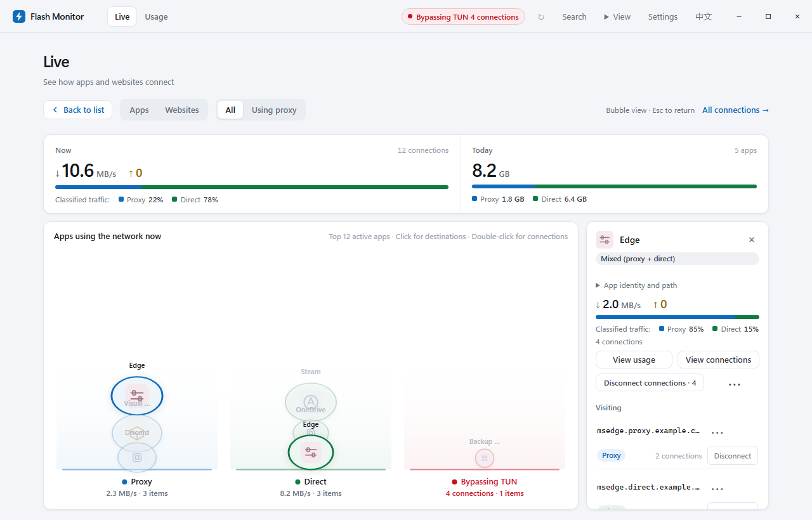

# Flash Monitor

**Inspect app and website connections, track cumulative proxy traffic, and block IPv6 for selected apps or websites.**

**English** · [简体中文](README.zh-CN.md)

A local traffic monitor for FlClash / Clash Meta (mihomo) on Windows, supporting TUN and system proxy setups.

[Download Windows installer](https://github.com/finnheihei/FlashMonitor/releases/download/v0.9.13/FlashMonitor-0.9.13-setup.exe) · [All releases](https://github.com/finnheihei/FlashMonitor/releases) · [User guide (Chinese)](docs/usage-guide.md)

Is an app using a proxy or connecting directly? Which websites consume your proxy traffic? Which app is visiting a particular website? Flash Monitor connects these details so you can follow the traffic from app to website to route.



Real application UI captured on Windows / Edge with demo data; no real proxy service was connected.

## See where connections go

Switch between **Apps** and **Websites** on the Live page. Check upload and download rates, distinguish proxy, direct, mixed and unknown routes, or filter for apps using a proxy.

Expand an app to see the websites it visits. Switch to websites to find the apps connecting to the same destination. Detected connections bypassing TUN have a notice and a details entry.

When subscription usage is available and enabled, the live list shows a compact summary of usage, remaining quota and expiry. Expand it for more details and a refresh action. Failed reads retain a retry action; cached data shows its status and available update time. Changing subscriptions does not reuse another plan’s balance.



## Find where your proxy traffic goes

Usage opens with **today's proxy usage first**. The main metric follows the current filters: total, proxy or direct usage, with node traffic shown in the node view. Proxy and direct traffic are shown separately for apps and websites, so a large direct download does not look like proxy consumption.

- **Three dimensions:** apps, websites and nodes; the node view shows traffic through each node.
- **Five periods:** last hour, today, last 7 days, last 30 days and all time.
- **Further analysis:** search, sort, expand details and export CSV.



Expand an app to inspect its website usage, or expand a website to see the associated apps. Historical details respect the selected period; the interface explains when coverage is incomplete.



## Inspect and disconnect connections

View the remote address, outbound and node. Disconnect a single connection or a group belonging to an app or website. Results distinguish successful and failed requests.

Connections and Usage show active filter labels with a clear action, making it easier to return to the full result set.

Disconnection requires connection IDs provided by the proxy core. Connections bypassing the core cannot be disconnected here. Apps may reconnect automatically; disconnecting does not permanently block network access.



## Block IPv6 for selected apps or websites

Open **IPv6 blocking** from an app or website's `⋯` menu and toggle **Block IPv6** for that scope, without disabling IPv6 globally on Windows or a network adapter. To choose a scope first, open **Settings → Clash Connection → Choose an app or website**.

This restricts new connections whose IPv6 destinations are identified by the core. It does not guarantee IPv4 fallback or control traffic bypassing the core. Current requirements include a verifiable FlClash configuration, a local controller and a Meta core in rule mode; app scopes also require strict / always process identification. See [IPv6 scope and limitations (Chinese)](docs/scoped-ipv6.md).



## Built for everyday use

- **List and bubble views:** the top **View** menu switches between the list and the top 12 active apps in bubbles. Use Back to list or press `Esc` to return.
- **Compact notices:** routine notices share a collapsible group and a **Collapse for today** action; new notices still update the count. Storage errors stay visible separately.
- **App icons:** native icons when available, stable generic icons otherwise.
- **Tray collection:** closing the window keeps collection running by default. Opening the app again brings back the existing window.
- **Local records:** usage is stored locally; the service listens only on `127.0.0.1`.

Check for updates and find uninstall instructions under **Settings → About**. **Settings → Data → Advanced maintenance** is collapsed by default and contains the installation folder, diagnostics, rule drafts and legacy IPv6 actions.



## Install and connect

1. Download `FlashMonitor-0.9.13-setup.exe` from [Releases](https://github.com/finnheihei/FlashMonitor/releases/latest) and run it. No Python installation is needed. Exit the old Monitor from the tray before upgrading.
2. Install Microsoft Edge WebView2 Runtime if needed and enable **External Controller** in your Clash / mihomo client.
3. Open Monitor and enter the controller address and secret under Settings → Clash Connection.

The installer defaults to `%LOCALAPPDATA%\FlashMonitor`, creates a Start menu shortcut and normally does not require administrator privileges. Uninstalling retains historical traffic records by default. See [installation and data migration (Chinese)](docs/windows-installer.md).

Releases also include a standalone `FlashMonitor.exe` and `SHA256SUMS.txt`. Builds are currently unsigned.

## Interface language

The current source version defaults to English. Use **中文** in the top bar to switch to Chinese, or **English** to switch back. The preference is saved in the local browser / WebView profile. Switching reloads the interface and restores the current page, search, filters and expanded rows. Unsaved form input is not retained; a prompt appears before switching from settings or an open dialog.

App-provided names, domains, paths, rules and controller diagnostics retain their original text. Native tray messages are not part of this interface translation. The published v0.9.13 installer predates this language feature; a new installer has not yet been released.

## Accounting and coverage

- Proxy usage covers connections observed by Clash / mihomo. It is not a provider bill, and unseen traffic is not estimated.
- Unconfirmed routes remain unknown rather than being counted as direct. Complete coverage of system traffic or all proxy bypasses is not guaranteed.
- Time-based app–website details are kept for up to 7 days and are capacity-limited. Last-30-days and all-time views do not guarantee complete website details for the entire period; available coverage is shown. App lifetime totals follow their existing retention settings.
- Scoped IPv6 blocking is an auxiliary control, not strict IPv4 enforcement. Existing connections are not closed automatically. Loading restrictions may briefly affect networking while the core reloads.

## Documentation and source

[User and developer guide](docs/usage-guide.md) · [Installation and migration](docs/windows-installer.md) · [IPv6 limitations](docs/scoped-ipv6.md) · [v0.9.13 notes](docs/release-notes-0.9.13.md)

The detailed documents above are currently in Chinese. Running from source requires **Python 3.11+**:

```bat
start.cmd
```

Headless: `python -u monitor.py --no-gui --port 8787`. Build: `build.cmd`.

## License

[MIT](LICENSE)
