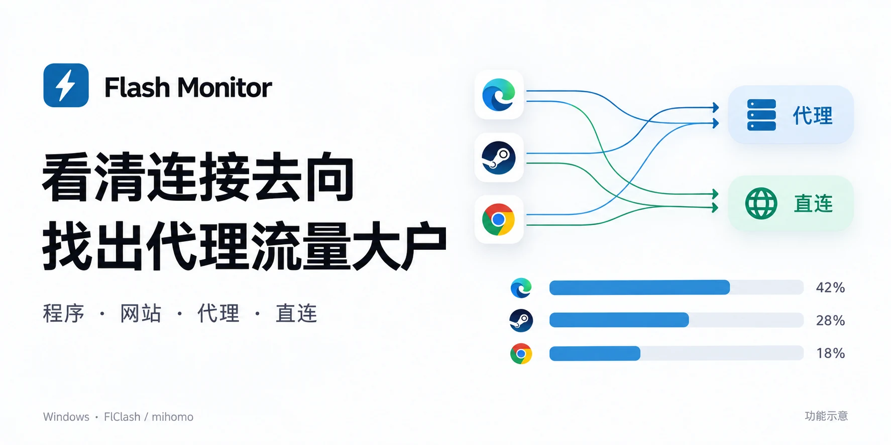

# Flash Monitor

**看清连接去向，找出代理流量大户。**

[下载 Windows 安装包](https://github.com/finnheihei/FlashMonitor/releases/download/v0.9.13/FlashMonitor-0.9.13-setup.exe) · [所有版本](https://github.com/finnheihei/FlashMonitor/releases) · [使用说明](docs/usage-guide.md)



给 [FlClash](https://github.com/chen08209/FlClash) / Clash Meta（mihomo）用户的 Windows 本机流量监视器。支持 TUN 与系统代理，把**程序、网站、连接方式和代理用量**放到一起看。

你可以顺着一个问题查到底：**哪个程序在用网 → 正在访问哪个网站 → 走代理还是直连 → 消耗了多少代理流量。**

> 下方图片为功能示意图，图中应用、网站与数值仅作示例，不代表实际界面截图、路由规则或实测结果。

## 看清每个程序、每个网站的连接去向

实时列表同时展示程序与网站。代理、直连、混合和未知分别标明，无法确认的连接不会被当成直连。展开程序就能看到正在访问的目标；也可以切到网站维度，查看哪些程序连接了同一个网站。

想只看代理相关活动，可以切换“有代理连接”。发现绕过 TUN 的连接时，顶部会提供提示与明细入口。

## 找出谁吃掉了代理流量


用量页默认查看**今天的代理流量排行**，优先找到消耗代理流量最多的程序和网站。代理与直连分列展示，避免把直连下载误当成代理消耗。

- **三个维度**：程序、网站、代理节点。
- **五个时段**：近 1 小时、今天、近 7 天、近 30 天、累计。
- **继续分析**：按用量排序、展开明细、导出 CSV。

## 从程序追到网站，也能从网站反查程序


浏览器用了很多流量？展开它，就能查看各网站的用量。某个网站排在前面？从网站继续展开，查看关联程序，减少在多个列表之间来回查找。

实时连接与历史用量各自展示；历史明细不足时会说明范围，不会用当前连接补造过去的数据。

## 找到连接，随时断开


在程序、网站或连接明细中，查看远端、当前出站与节点，并断开单条或该范围内的一组连接。执行中避免重复点击，部分成功或失败会明确提示。

**断开针对 Clash / mihomo 内核提供的连接 ID。** 绕过内核的连接暂不支持断开；程序可能自动重连，断开不等于永久屏蔽。

## 日常使用更顺手

- **列表与小球视图**：小球显示前 12 个活跃程序；常驻“返回列表”，也可按 `Esc` 返回。
- **清晰的程序身份**：优先显示程序原生图标，缺失时分配稳定的简约通用图标；详情可查看身份与路径来源。
- **托盘持续采集**：关闭窗口默认收进托盘，再次打开会唤起已有窗口。
- **本机保存**：流量记录保留在本地，服务只监听 `127.0.0.1`。
- **按需屏蔽 IPv6**：在应用或网站的连接设置中操作；支持范围与恢复，兼容条件见 [IPv6 执行说明](docs/scoped-ipv6.md)。

## 下载与开始使用

1. 从 [Releases](https://github.com/finnheihei/FlashMonitor/releases/latest) 下载 **FlashMonitor-0.9.13-setup.exe**，双击安装，无需安装 Python。升级前先从托盘退出旧版 Monitor。
2. 在 Clash 客户端中打开“外部控制器”。
3. 打开 Monitor，在“设置 → Clash 接入”填写控制器地址与密钥，然后查看“实时”与“用量”。

默认安装到 `%LOCALAPPDATA%\FlashMonitor`，创建开始菜单快捷方式，正常无需管理员权限。需要 Microsoft Edge WebView2 Runtime。卸载默认保留流量记录；其他目录中的旧数据迁移见 [Windows 安装说明](docs/windows-installer.md)。

发布页同时提供独立的 `FlashMonitor.exe` 与 `SHA256SUMS.txt`。安装包暂未配置代码签名。

## 统计范围

- 代理用量来自 Clash / mihomo 已观察到的连接，不等同于机场账单；未观察到的流量不会补算。
- 同一程序可能同时走代理与直连，具体网站的去向以当前规则和连接为准。
- 程序与网站的分时明细最多保留 7 天，且受容量限制；30 天或累计查询出现明细不足时会提示，程序总累计按原有保留设置保存。

## 文档与源码

[详细使用与开发说明](docs/usage-guide.md) · [安装与数据迁移](docs/windows-installer.md) · [IPv6 范围与限制](docs/scoped-ipv6.md) · [版本说明](docs/release-notes-0.9.13.md)

源码运行需要 **Python 3.11+**，运行时只用标准库：

```bat
start.cmd
```

无窗口运行：`python -u monitor.py --no-gui --port 8787`。打包：`build.cmd`。

## License

[MIT](LICENSE)
