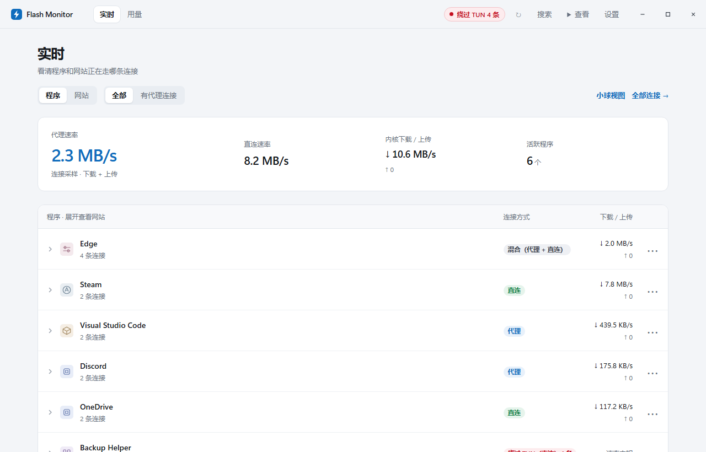
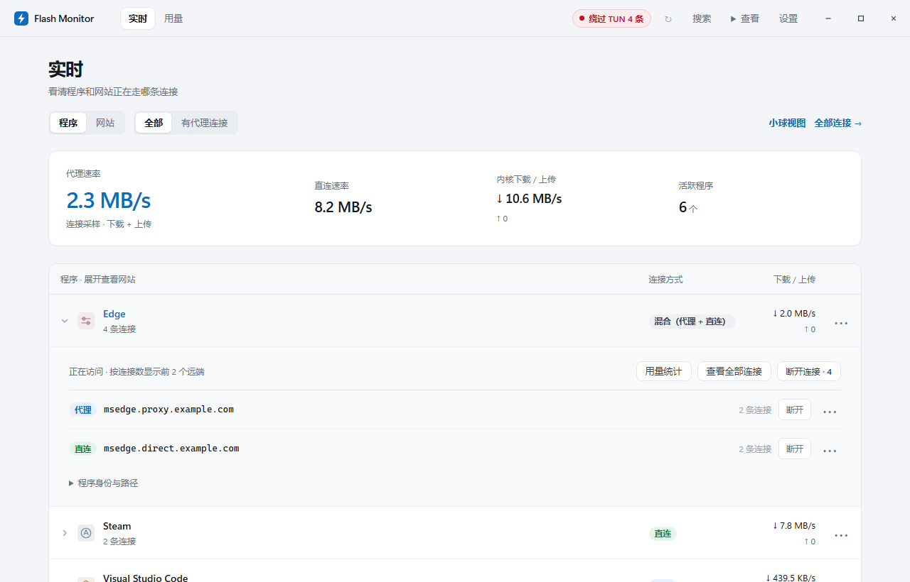
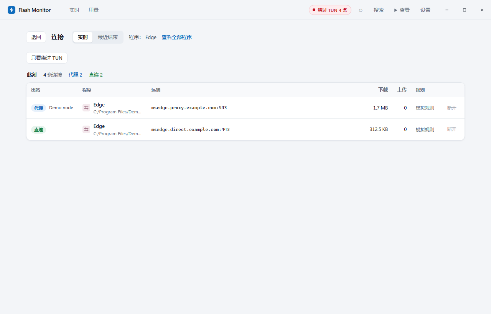
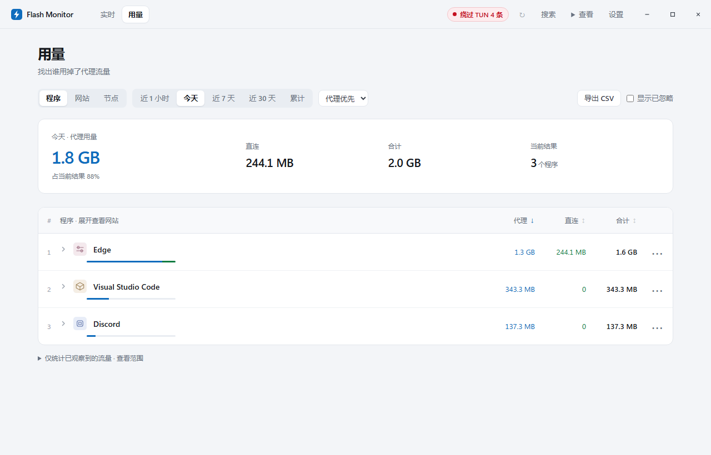
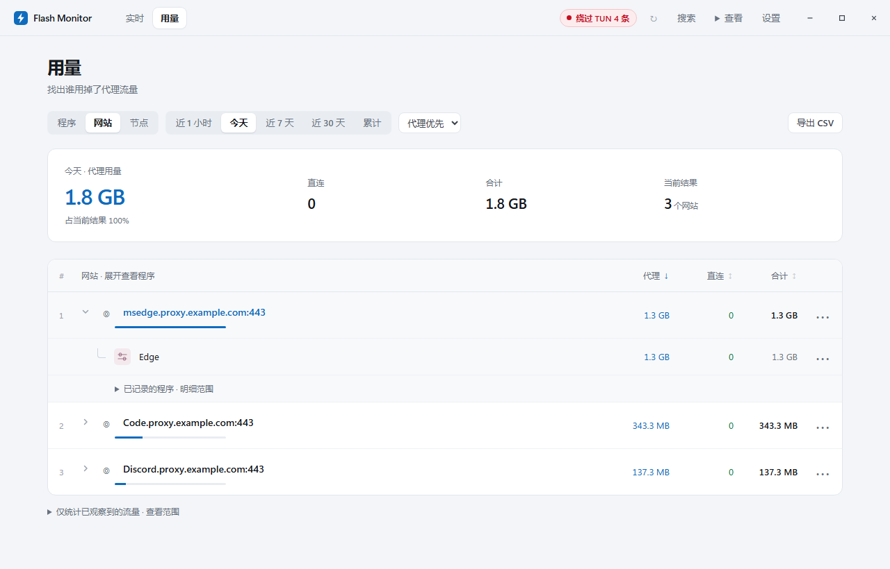
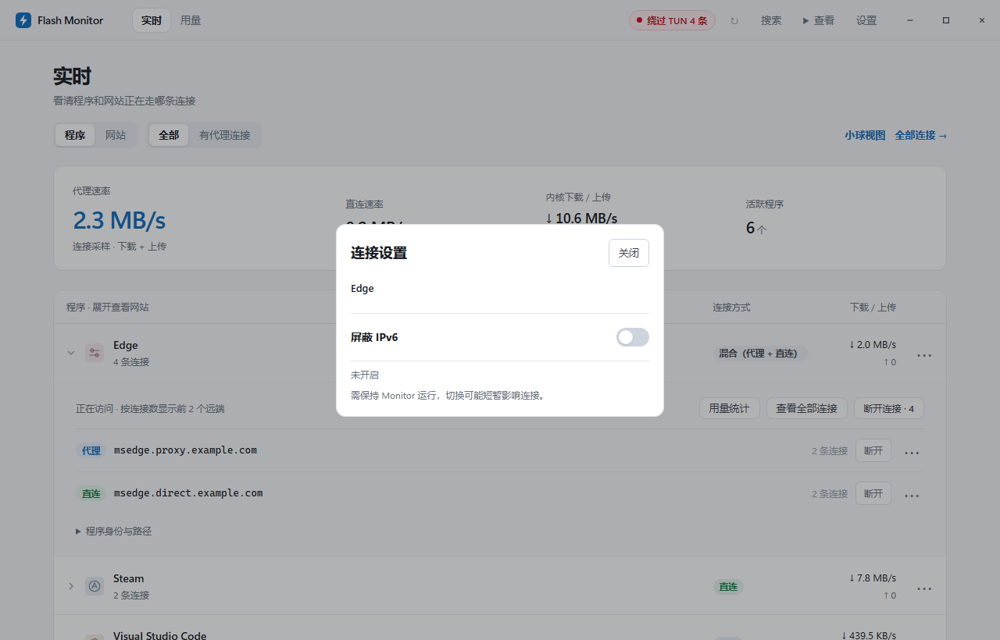
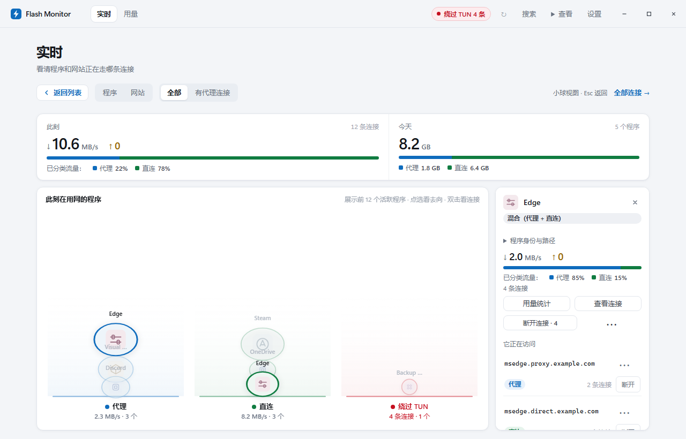

# Flash Monitor

**面向 FlClash / mihomo 用户的本机流量监视工具：网络状态明细、累计代理流量计数与按需 IPv6 屏蔽。**

当前版本：`v0.9.13`（正在为 `1.0` 做准备） · 平台：Windows

[下载 Windows 安装包](https://github.com/finnheihei/FlashMonitor/releases/latest) · [所有版本](https://github.com/finnheihei/FlashMonitor/releases) · [使用说明](docs/usage-guide.md)

使用 FlClash 或 mihomo 时，你可能想知道：

- **连接去了哪里？** 同一个程序中，哪些网站走代理、哪些走直连？是否检测到绕过 TUN 的连接？
- **谁消耗了代理额度？** 今天、近几天或历史累计中，哪个程序、网站、节点的代理用量最多？
- **能否局部屏蔽 IPv6？** 遇到 IPv6 分流问题时，能否只处理指定应用或网站，而不关闭系统全局 IPv6？

Flash Monitor 运行于 Windows 本机，通过内核外部控制器获取连接与流量信息，支持 **TUN 与系统代理场景**。它是流量与连接监视工具，不是代理客户端。

## 界面与功能预览

> 以下均为 **真实界面截图，数据为演示数据**。使用仓库原版界面在隔离的 Windows / Edge 环境中截取，未连接真实代理服务；程序、网站、节点和流量仅用于展示功能。



*实时网络状态明细：查看活跃程序的连接去向。真实界面截图，数据为演示数据。*

## 核心功能

### 1. 网络状态明细与双向追踪

按程序或网站查看当前连接去向，定位程序内部的流量来源：

- **四种状态**：区分代理、直连、混合、未知；无法确认的连接不会被当作直连。
- **代理连接筛选**：只查看包含确定代理连接的程序，包含同时存在代理与直连的混合状态程序。
- **程序与网站双向展开**：展开程序查看其访问的网站；从网站反查关联的本地程序。
- **绕过 TUN 提示**：对检测到的绕过连接提供提示与明细入口，不承诺识别全部绕过行为。
- **连接明细与管理**：查看远端地址、当前出站、所选节点，断开单条连接或按程序、网站批量断开内核连接；操作失败或部分成功时显示反馈。



*展开程序查看正在访问的网站与连接状态；程序范围提供批量断开入口。真实界面截图，数据为演示数据。*



*查看单条连接的远端、出站与节点。真实界面截图，数据为演示数据。断开仅针对内核提供连接 ID 的连接；程序可能自动重连。*

### 2. 累计代理流量计数与多维排行

默认显示**今天的代理流量排行**，帮助找出主要用量来源。

| 统计选项 | 支持范围 |
| --- | --- |
| 时间跨度 | 近 1 小时、今天、近 7 天、近 30 天、累计 |
| 排行维度 | 程序、网站、节点 |
| 用量分类 | 代理与直连分列展示 |
| 进一步分析 | 按用量排序、展开关联明细、导出 CSV |



*累计代理流量统计排行。真实界面截图，数据为演示数据。*



*从网站排行展开，确认关联的本地程序。真实界面截图，数据为演示数据。*

*CSV 导出当前显示的统计结果，数值单位为字节。程序与网站的分时交叉明细最多保留 7 天；更长时段的汇总不代表拥有完整的逐项交叉明细。*

### 3. 按应用或网站屏蔽 IPv6

在应用或网站的 **连接设置** 中打开「屏蔽 IPv6」，关闭开关即可恢复；通用入口可选择应用或输入域名。支持网站精确匹配、包含子域名，以及某应用中的指定网站。

- 仅限制**内核识别到的 IPv6 目标新连接**，IPv4 沿用原代理或直连路线；已有连接不会主动断开。
- 不修改系统或网卡的全局 IPv6 开关，不保证应用自动回退 IPv4，也不控制代理远端解析的出口地址族。
- 当前执行路径要求可核实的 **FlClash schema 3 配置、本机 IP 控制器和 rule 模式的 Meta 内核**；应用范围还需要 strict / always 进程识别。监视功能支持的接入场景不代表 IPv6 屏蔽支持所有客户端组合。
- 开启、撤销与恢复维护可能重载内核，短暂影响网络；关闭到托盘继续维护，完全退出后不再维护。

兼容条件、配置核实与恢复机制见 [IPv6 范围与限制](docs/scoped-ipv6.md)。这是一项辅助控制功能，不等同于严格强制 IPv4。



*从应用进入连接设置，直接查看该对象的 IPv6 屏蔽开关。真实界面截图，数据为演示数据。*

### 4. 日常运行与视图体验

- **列表与小球视图**：小球展示前 12 个活跃程序，可通过「返回列表」或 `Esc` 返回。
- **单实例与托盘采集**：再次打开会唤起已有窗口；关闭窗口默认进入托盘继续采集，彻底退出使用托盘菜单。
- **程序图标**：优先显示原生图标，无法获取时分配稳定的通用图标。
- **本机存储**：流量记录保存在本机数据库，后台服务仅监听 `127.0.0.1`。



*小球视图最多展示前 12 个活跃程序；图中按实际演示数量显示。可点击返回列表或按 Esc 返回。真实界面截图，数据为演示数据。*

## 安装与接入

1. **准备环境**：Windows 与 Microsoft Edge WebView2 Runtime。当前安装器面向 x64 兼容环境；最低 Windows 版本尚未在项目文档中明确验收。
2. **下载安装**：从 [最新 Releases](https://github.com/finnheihei/FlashMonitor/releases/latest) 下载名称以 `-setup.exe` 结尾的安装包，无需安装 Python。升级前先从托盘退出旧版 Monitor。
3. **开启控制器**：在 FlClash / mihomo 客户端中开启「外部控制器（External Controller）」。
4. **填写接入信息**：打开 Flash Monitor 的「设置 → Clash 接入」，填写对应控制器地址与密钥，再查看「实时」与「用量」。

默认安装到 `%LOCALAPPDATA%\FlashMonitor`，创建开始菜单快捷方式，正常安装无需管理员权限。卸载默认保留本机历史流量记录；旧数据迁移见 [Windows 安装说明](docs/windows-installer.md)。

发布页同时提供独立的 `FlashMonitor.exe` 与 `SHA256SUMS.txt`。安装包暂未配置代码签名。

## 统计口径与限制

- **统计来源**：代理统计主要来自 Clash / mihomo 内核已观察到的连接。未观察到的流量不会补算；服务商倍率与计费方式可能不同，统计不等同于服务商账单。
- **未知与覆盖范围**：无法确认归属或状态的连接标记为未知，不计入直连。工具不承诺覆盖所有系统流量或识别全部绕过代理行为。
- **明细保留**：程序与网站的分时交叉明细最多保留 **7 天**，并受容量限制；近 30 天与累计视图可提供汇总计数，但不包含完整的 30 天程序—网站交叉明细。明细不足时会提示，不影响原有总累计保留设置。
- **连接断开**：仅支持内核提供连接 ID 的连接，绕过内核的连接暂不支持。断开后应用可能自动重连。
- **IPv6 控制**：受客户端配置、域名可见性、进程识别及 fake-ip 等条件限制；绕过内核的流量不在该功能控制范围内。
- **功能边界**：不提供自动优化路由、降低延迟或节省固定比例流量的承诺。

## 文档与源码

[使用与开发说明](docs/usage-guide.md) · [安装与数据迁移](docs/windows-installer.md) · [IPv6 范围与限制](docs/scoped-ipv6.md) · [版本说明](docs/release-notes-0.9.13.md) · [截图与发布素材](docs/publishing-guide.md)

源码运行需要 **Python 3.11+**，运行时只用标准库：

```bat
start.cmd
```

无窗口运行：`python -u monitor.py --no-gui --port 8787`。打包：`build.cmd`。

## 许可证

本项目采用 [MIT License](LICENSE)。
