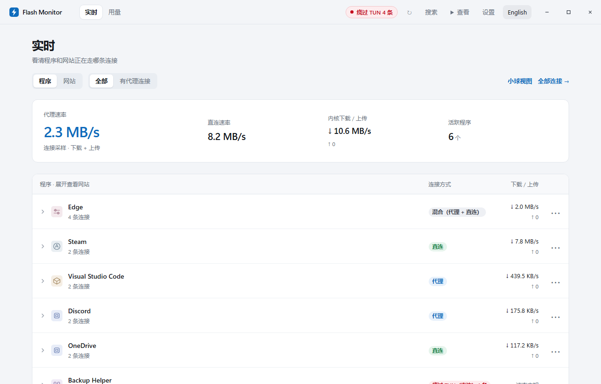
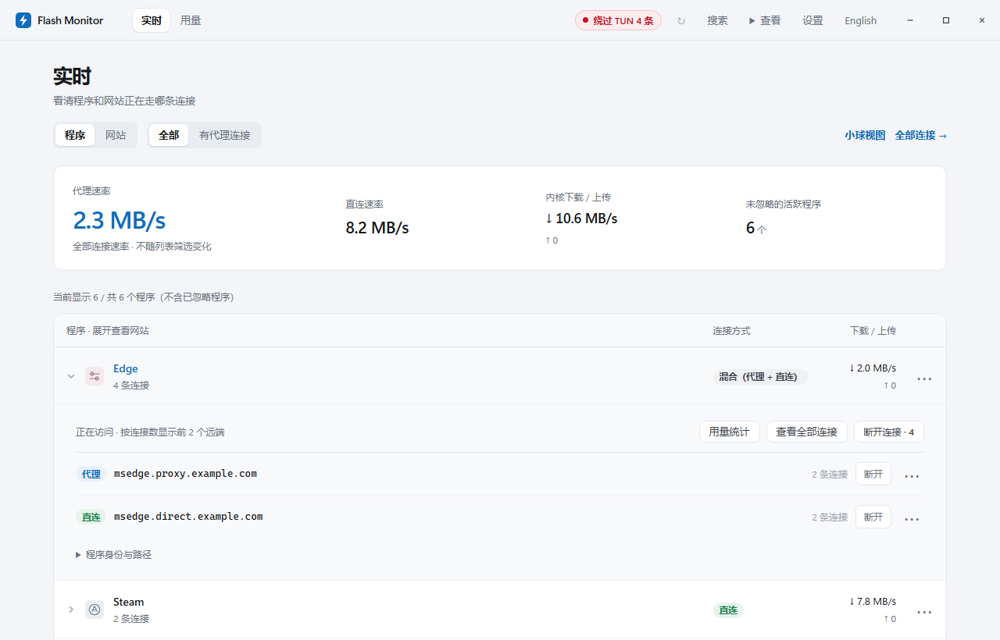
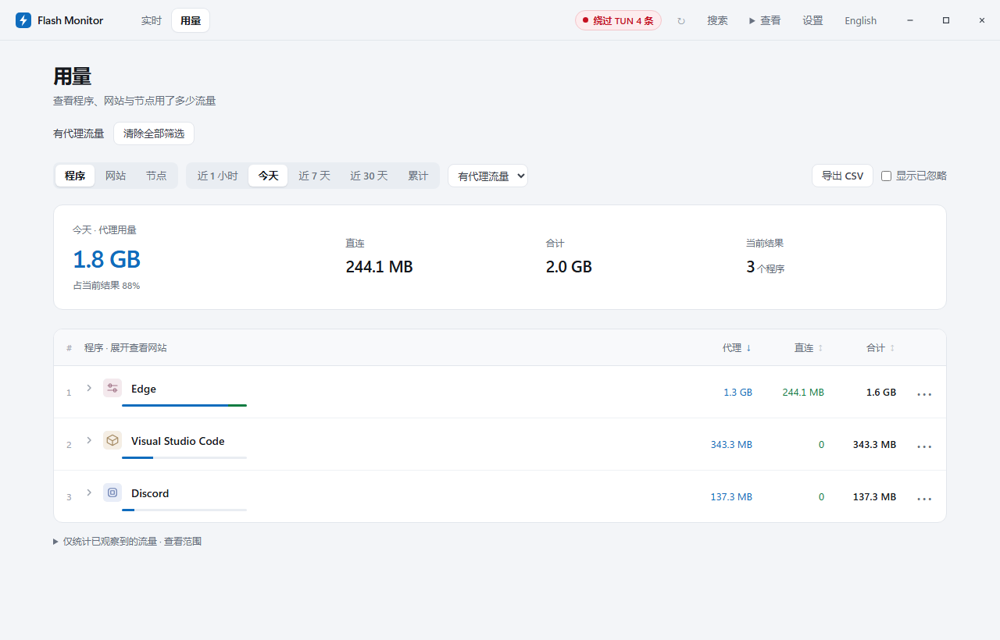
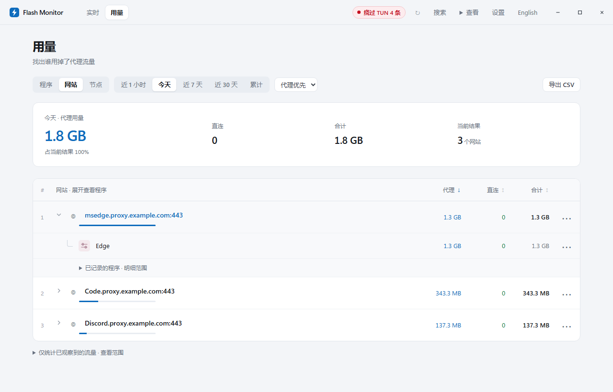
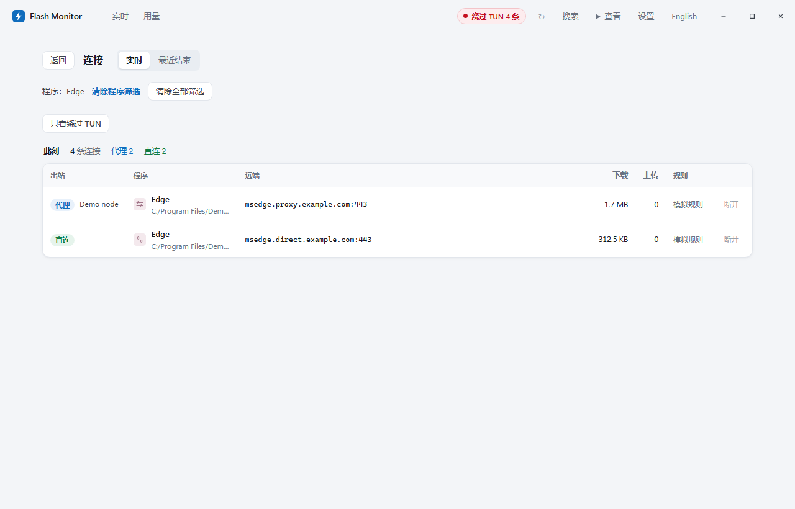
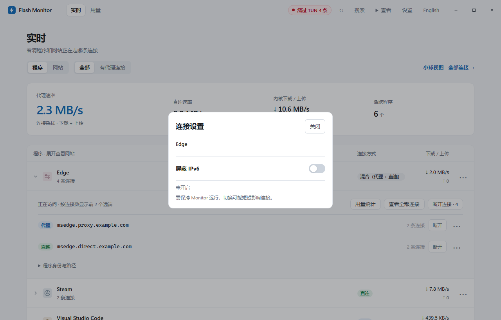
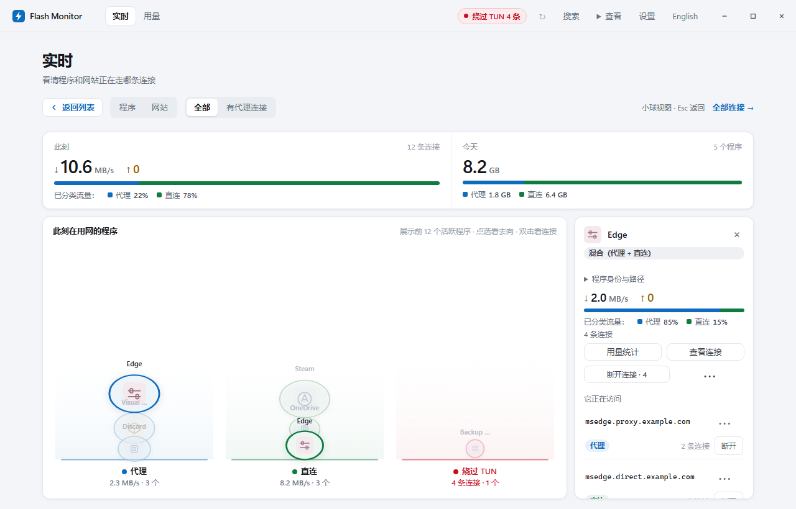

# Flash Monitor

[English](README.md) · **简体中文**

**查看程序与网站连接状态明细，统计累计代理流量，支持按应用或网站屏蔽 IPv6。**

面向 FlClash / Clash Meta（mihomo）用户的 Windows 本机流量监视工具，支持 TUN 与系统代理场景。

当前版本：`v0.9.14` · [下载 Windows 安装包](https://github.com/finnheihei/FlashMonitor/releases/download/v0.9.14/FlashMonitor-0.9.14-setup.exe) · [所有版本](https://github.com/finnheihei/FlashMonitor/releases) · [使用说明](docs/usage-guide.md)

程序有没有走代理？代理流量花在了哪些网站？某个网站又是哪个程序在访问？Flash Monitor 把程序、网站、连接去向和流量用量放在一起，方便顺着问题查下去。



真实软件界面截图，数据为演示数据。在 Windows / Edge 中截取，未连接真实代理服务。

## 网络状态明细与双向追踪

在「实时」页切换程序与网站视角，查看连接去向和上传、下载速率。代理、直连、混合和未知分别标明，也可以只看「有代理连接」的程序。

展开程序，查看它正在访问的网站；切换到网站视角，反查发起连接的程序。检测到绕过 TUN 的连接时，页面会提供提示和明细入口。

启用订阅显示且能读取用量时，实时列表会显示紧凑的订阅摘要，包括已用、可用的剩余额度与到期信息；展开可查看详情并刷新。读取失败时保留重试入口，缓存数据标明状态和可用的更新时间；更换订阅不会沿用其他套餐的余额。



## 累计代理流量与多维排行

「用量」页默认显示**今天的代理用量排行**，优先找出代理流量大户。主指标跟随当前筛选显示总用量、代理用量或直连用量，节点维度显示节点流量。程序与网站的代理、直连用量分列展示，避免把直连下载当成代理消耗。

- **三个维度**：程序、网站、节点；节点页查看各节点的流量。
- **五个时段**：近 1 小时、今天、近 7 天、近 30 天、累计。
- **继续分析**：搜索、按用量排序、展开明细、导出 CSV。



浏览器消耗很多流量，可以展开查看网站用量；某个网站排在前面，可以继续展开查看关联程序。历史明细按所选时段展示，数据不足时会说明范围。



## 连接明细与按范围断开

查看连接的远端地址、当前出站和节点信息，支持断开单条连接，也可以按程序或网站批量断开内核连接。执行结果会区分成功与失败。

连接与用量页会显示当前筛选标签，并提供清除入口，方便回到完整结果。

断开仅针对内核提供连接 ID 的连接；绕过内核的连接暂不支持。程序可能自动重连，断开当前连接不等于永久禁止联网。



## 按应用或网站屏蔽 IPv6

从应用或网站行尾的 `⋯` 菜单打开「IPv6 屏蔽」，对所选范围开启或关闭「屏蔽 IPv6」，无需全局关闭系统或网卡 IPv6。也可从「设置 → Clash 接入 → 选择应用或网站」先选择范围。

该功能限制核心已识别的 IPv6 目标新连接，不保证程序自动回退到 IPv4，也不控制绕过核心的流量。当前需要可核实的 FlClash 配置、本机控制器和 rule 模式的 Meta 核心；应用范围还需要 strict / always 进程识别。具体条件与恢复方式见 [IPv6 范围与限制](docs/scoped-ipv6.md)。



## 日常运行与小球视图

- **两种视图**：顶部「查看」菜单切换列表与小球，小球展示前 12 个活跃程序；可点击「返回列表」或按 `Esc` 返回。
- **紧凑提醒**：普通提醒集中在可折叠区域，可选择「今天收起」，新提醒仍更新数量；存储错误独立保持可见。
- **清晰的程序图标**：优先显示原生图标，缺失时分配固定通用图标。
- **托盘后台采集**：单实例运行，关闭窗口默认收进托盘；再次打开会唤起已有窗口。
- **本机保存**：流量记录保存在本机数据库，服务仅监听 `127.0.0.1`。

检查更新与卸载说明在「设置 → 关于」。「设置 → 数据 → 高级维护」默认折叠，收纳打开安装目录、复制诊断信息、规则草稿与旧 IPv6 方案。



## 安装与接入

1. 从 [Releases](https://github.com/finnheihei/FlashMonitor/releases/latest) 下载 `FlashMonitor-0.9.14-setup.exe`，双击安装，无需配置 Python。升级前先从托盘退出旧版 Monitor。
2. 确保已安装 Microsoft Edge WebView2 Runtime，并在 Clash / mihomo 客户端中开启外部控制器（External Controller）。
3. 打开 Monitor，在「设置 → Clash 接入」填写控制器地址与密钥，开始查看「实时」与「用量」。

默认安装至 `%LOCALAPPDATA%\FlashMonitor`，创建开始菜单快捷方式，当前用户安装正常无需管理员权限。卸载默认保留历史流量记录；迁移其他目录中的数据请参阅 [Windows 安装说明](docs/windows-installer.md)。

发布页也提供独立的 `FlashMonitor.exe` 和 `SHA256SUMS.txt`。安装包暂未配置代码签名。

## 界面语言

程序默认显示英文。点击顶部「中文」切换中文，点击「English」切回英文；偏好保存在本机浏览器 / WebView 配置中。切换会重新载入界面，并恢复当前页面、搜索、筛选和展开项。未保存的表单输入不会保留，设置页或弹窗打开时会先提示。

程序自带名称、域名、路径、规则和控制器诊断保留原文，原生托盘提示尚未纳入此次翻译。v0.9.14 安装包已包含语言切换。
## 统计口径与限制

- **统计来源**：代理用量来自 Clash / mihomo 已观察到的连接，不等同于服务商账单；未观察到的流量不会补算。
- **状态与覆盖范围**：无法确认的连接标为未知，不计入直连；不承诺覆盖全部系统流量或识别所有绕过代理的行为。
- **明细保留**：程序与网站的分时交叉明细最多保留 7 天，且受容量限制。近 30 天与累计查询不保证包含完整的同期网站明细，页面会提示可用范围；程序总累计按原有保留设置保存。
- **IPv6 控制**：属于所选范围的辅助控制，不等同于严格强制 IPv4。应用既有连接不会被主动断开，加载限制时可能因核心配置重载短暂影响网络。

## 文档与源码

[详细使用与开发说明](docs/usage-guide.md) · [安装与数据迁移](docs/windows-installer.md) · [IPv6 范围与限制](docs/scoped-ipv6.md) · [版本说明](docs/release-notes-0.9.14.md)

源码运行需要 **Python 3.11+**：

```bat
start.cmd
```

无窗口运行：`python -u monitor.py --no-gui --port 8787`。打包：`build.cmd`。

## License

[MIT](LICENSE)
